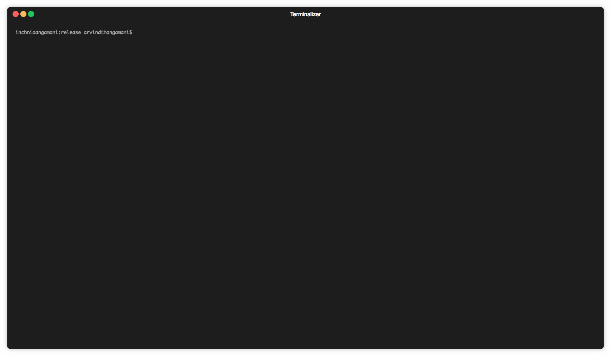

# kctl

> A powerful CLI wrapper that makes Kubernetes commands much easier ⚡

[](https://travis-ci.org/alaminopu/kctl)
[](LICENSE.md)

## Why kctl?

`kubectl` commands are verbose. `kctl` lets you skip the boilerplate:

```bash
# Before (kubectl)
kubectl get pods -n staging | grep myapp
kubectl logs -f $(kubectl get pods -n staging -o=name | grep myapp | head -1) -n staging
kubectl exec -it $(kubectl get pods -n staging --no-headers -o custom-columns=:metadata.name | grep myapp | head -1) -n staging -- sh
kubectl rollout restart deployment/myapp -n staging
kubectl config use-context production

# After (kctl)
kctl pod myapp -n staging
kctl log myapp -n staging
kctl exec myapp -n staging
kctl restart myapp -n staging
kctl ctx production
```

## Demo



## Commands

| Command | Description | Example |
|---------|-------------|---------|
| `pod` | List pods (optionally filter by app) | `kctl pod myapp` |
| `svc` | List services | `kctl svc myapp` |
| `deploy` | List deployments | `kctl deploy myapp` |
| `log` | Stream logs from a pod | `kctl log myapp` |
| `exec` | Shell into a pod | `kctl exec myapp` |
| `forward` | Port-forward to a pod | `kctl forward myapp 8080:80` |
| `describe` | Describe a pod | `kctl describe myapp` |
| `delete` | Delete a matching pod | `kctl delete myapp` |
| `restart` | Rollout restart a deployment | `kctl restart myapp` |
| `scale` | Scale a deployment | `kctl scale myapp 3` |
| `ctx` | List or switch contexts | `kctl ctx production` |
| `top` | Show pod resource usage | `kctl top myapp` |
| `events` | Show events (sorted by time) | `kctl events myapp` |
| `ing` | List ingress resources | `kctl ing myapp` |
| `cm` | List configmaps | `kctl cm myapp` |
| `secret` | List secrets | `kctl secret myapp` |
| `set-namespace` | Persist default namespace | `kctl set-namespace -n staging` |

### Global Flags

| Flag | Description |
|------|-------------|
| `-n, --namespace <ns>` | Target namespace (default: `default`) |
| `-h, --help` | Show help |
| `-V, --version` | Show version |

📖 **[Full Usage Docs →](https://github.com/alaminopu/kctl/wiki)**

## Installation

### Homebrew

```bash
brew tap alaminopu/kctl https://github.com/alaminopu/kctl.git
brew install kctl
```

### From Source

Prerequisites: [Rust & Cargo](https://rustup.rs/)

```bash
curl https://sh.rustup.rs -sSf | sh     # Install Rust (if needed)
cargo build --release                     # Build
chmod a+x target/release/kctl            # Make executable
mv target/release/kctl /usr/local/bin/   # Install to PATH
```

## Contributing

1. Fork the repo
2. Create an issue in the issue section
3. Write code and commit changes
4. Send a PR to the `master` branch

## Authors

- **Md. Al-Amin** — [alaminopu](https://github.com/alaminopu)
- **Arvind Thangamani** — [dnivra26](https://github.com/dnivra26)

See the full list of [contributors](https://github.com/alaminopu/kctl/contributors).

## License

This project is licensed under the MIT License — see [LICENSE.md](LICENSE.md) for details.